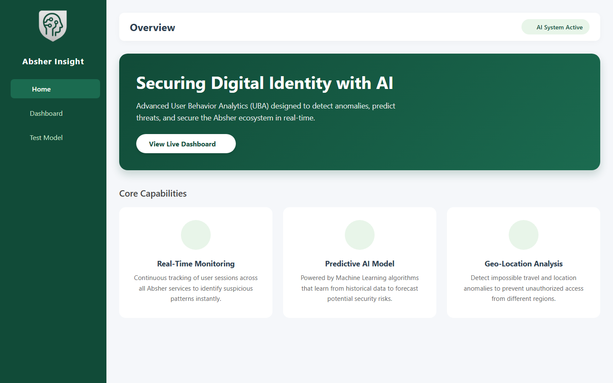
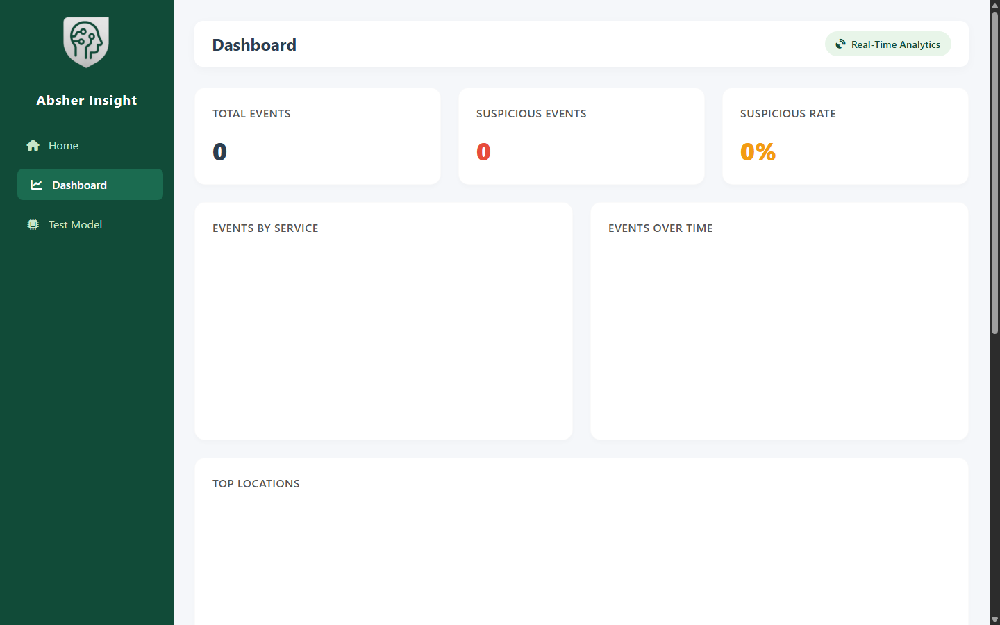

<a href="https://github.com/Abdulel3h">
  <picture>
    <source media="(max-width: 600px)" srcset="assets/terminal-mobile.svg">
    
  </picture>
</a>

**A behavioural-risk prototype that scores access events with explainable rules and shows the unusual ones on an operations dashboard.**

Prototype on synthetic data. An independent demonstration, **not affiliated with Absher or any government entity**, and not a deployed security system.

###### HOW IT WORKS

1. **Receive an event.** `POST /predict` takes service type, location, login time and action count.
2. **Apply the rules.** A location outside the listed Saudi cities, a login between 00:00 and 04:59, or more than 20 actions flags the event.
3. **Answer with reasons.** The response carries `prediction`, a rule-assigned `probability` and `details`.
4. **Aggregate.** `/api/stats` keeps totals, suspicious events, top services and locations in memory; an optional simulator keeps the dashboard moving.

###### EVIDENCE

- The hero's three events return exactly those predictions and probabilities under the current rules in `backend/main.py`.
- `tests/test_api.py` checks the `/predict` response schema and a suspicious case.
- The static dashboard in `dashboard/` reads live statistics from `/api/stats`.

**Not claimed:** `probability` is assigned by the rules, not a calibrated model score. The committed scikit-learn artifacts support experiments only; the live path is rule-based. State resets on restart, and no real citizen data is used anywhere. [All limitations](docs/overview.md#limitations)

<details>
<summary>Screenshots</summary>





Captured from the committed dashboard HTML.
</details>

###### QUICK START

```bash
cd backend
python -m venv .venv
. .venv/Scripts/activate           # macOS/Linux: . .venv/bin/activate
pip install -r requirements.txt
uvicorn main:app --reload
```

Score an event:

```bash
curl -X POST http://localhost:8000/predict \
  -H "Content-Type: application/json" \
  -d "{\"service_type\":\"Traffic\",\"location\":\"Riyadh\",\"login_time\":\"10:15\",\"actions_count\":2}"
```

Run the tests with `pip install -r requirements-dev.txt` and `python -m pytest tests`. Open the dashboard from `dashboard/` or serve it with a static server. [Optional environment](docs/overview.md#quick-start)

###### DOCUMENTATION

[Overview](docs/overview.md) · [Architecture](docs/architecture.md) · [Case study](docs/case-study.md) · [Engineering principles](docs/engineering-principles.md) · [Technical decisions](docs/technical-decisions.md) · [Reviewer guide](docs/reviewer-guide.md) · [Case study on abdulelah.de](https://www.abdulelah.de/projects/absher-insight-ai)

<sub>[Abdulelah Alkhathami](https://github.com/Abdulel3h) · [abdulelah.de](https://www.abdulelah.de) · No license file yet, so all rights are reserved by default.</sub>
